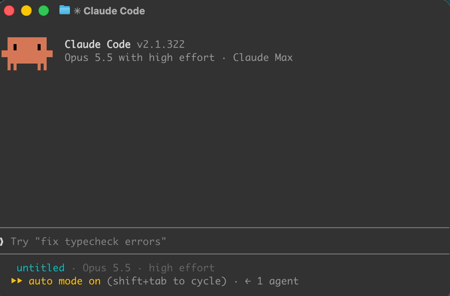
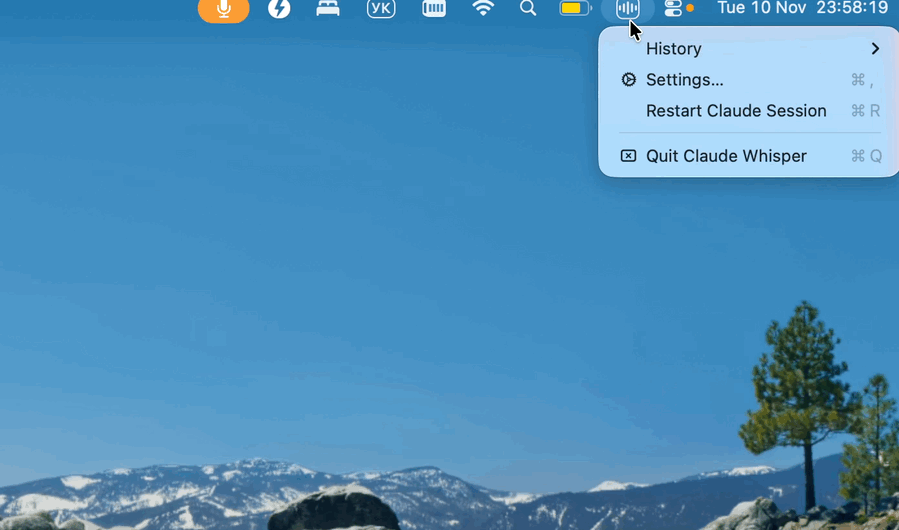
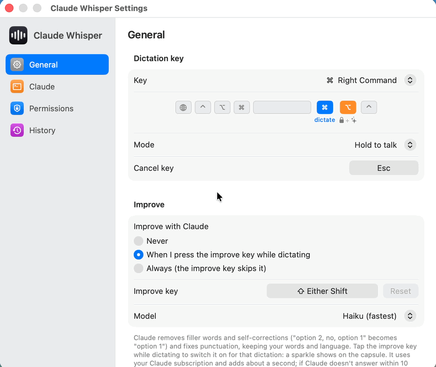

  

<h1 align="center">Claude Whisper</h1>

  <b>Hold a key, speak, let go: the text is typed where your cursor is.</b> 
  System-wide voice typing for macOS and Windows, on the Claude Code you already have.

  
  

  
  
  
  
  

  <a href="https://viachm.github.io/claude-whisper/">Website</a> ·
  <a href="#see-it-work">See it work</a> ·
  <a href="#install">Install</a> ·
  <a href="#keys">Keys</a> ·
  <a href="docs/GUIDE.md">Full guide</a>

---

Claude Whisper is a small menu bar (macOS) and tray (Windows) app around
[Claude Code](https://code.claude.com). It does no speech recognition of its own: it drives Claude
Code's built-in voice dictation in a hidden session, so it runs on the Claude account you already
use. Free and open source, with no extra subscription or API key.

## See it work

### Dictate into any app

Hold **Right Command**, speak, let go. A small capsule shows it is listening, and the text is typed
where your cursor is: here, at the Claude Code prompt.

  

### Find a dictation again

The menu bar icon keeps your last 30 dictations. Click one to copy it.

  

### Make it yours

Settings: the dictation key and mode, Improve, how the text is delivered, sounds and the capsule.

  

## Install

You need [Claude Code](https://code.claude.com) installed and signed in, with voice dictation
working: run `claude`, type `/voice` and hold Space.

### macOS 14 or later

1. Download [Claude-Whisper-macOS.zip](https://github.com/viachm/claude-whisper/releases/latest/download/Claude-Whisper-macOS.zip),
   unzip it and move **Claude Whisper.app** to Applications.
2. The app is not notarized, so macOS blocks the first launch: click **Open Anyway** in System
   Settings › Privacy & Security, or run
   `xattr -dr com.apple.quarantine "/Applications/Claude Whisper.app"`.
3. Allow **Accessibility** (to paste), **Input Monitoring** (to see the key) and **Microphone**.
   Settings opens with a banner that links to each one.

### Windows 10 or 11

1. Download [Claude-Whisper-Windows.zip](https://github.com/viachm/claude-whisper/releases/latest/download/Claude-Whisper-Windows.zip)
   (the [release](https://github.com/viachm/claude-whisper/releases/latest) also has an `-arm64`
   zip for ARM PCs), unzip it anywhere and run **ClaudeWhisper.exe**.
2. The app is not signed, so SmartScreen stops the first launch: click **More info**, then
   **Run anyway**.
3. Windows Settings › Privacy & security › Microphone must let desktop apps use the microphone.

To build either app yourself, see [CONTRIBUTING.md](CONTRIBUTING.md).

## Keys

| Do this | macOS | Windows |
|---|---|---|
| Talk: hold, speak, let go | **Right Command** | **Right Ctrl** |
| Lock it hands-free | **Right Option** while holding, or double-tap | **Right Alt** while holding, or double-tap |
| Stop when locked | tap the dictation key | tap the dictation key |
| Improve this dictation with Claude | tap **Shift** while talking | not yet |
| Cancel | **Esc** | **Esc** |

- Every key can be changed in Settings.
- The dictation key with another key (Cmd+C, Ctrl+C…) is a normal shortcut: nothing is pasted, and
  what you said is kept in History.
- **Improve** removes fillers and self-corrections ("option 2, no, option 1" → "option 1") and fixes
  punctuation, keeping your words and language. It adds about a second.
- With **Paste and press Return** in Settings (**Auto-send** on Windows), a dictation you held the
  key for is sent straight away; a locked one is only pasted.

## How it works

1. Claude Whisper runs `claude` in a hidden terminal of its own, with voice dictation on.
2. While you hold your key, it holds Claude Code's voice key in that terminal, and Claude Code
   transcribes into its prompt.
3. It takes the text out of the prompt and pastes it into the app you were in. Nothing is sent to
   Claude as a message, and the app makes no network connections of its own.

The details, every setting and troubleshooting are in the [full guide](docs/GUIDE.md).

## Contributing

Bug reports, ideas and pull requests are welcome: see [CONTRIBUTING.md](CONTRIBUTING.md), and
[SECURITY.md](SECURITY.md) for reporting a vulnerability privately.

> Unofficial: not made by, affiliated with or endorsed by Anthropic. "Claude" and "Claude Code" are
> Anthropic's names, used only to say what the app works with.

## License

[MIT](LICENSE)
